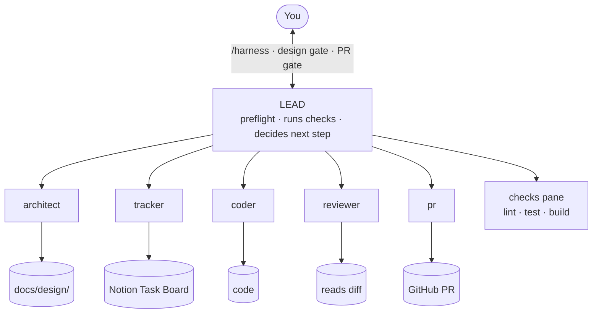

# Harness agent flow

How `/harness <task>` runs in herdr: one lead agent coordinates five helper agents, from design doc to an approved pull request for every sub-task.

Live page: https://claude.ai/artifact/CLW9mE2AZSM3ZagBQh2ojj

## Who talks to whom

Helpers never talk to each other. Every message goes through the lead (`herdr agent prompt` / `herdr agent read`).

## Tabs

One herdr workspace per repo, four tabs (herdr's own advice: "use tabs to separate views like agents, logs, server, or review"):

| Tab | Panes |
|---|---|
| `lead` | the lead you talk to, plus your nvim sidebar (`prefix+e`) |
| `agents` | architect, tracker, coder |
| `checks` | test runs; a dev server and its logs when needed |
| `review` | reviewer, pr |

Agent names carry a task prefix (e.g. `rl-coder`) because herdr names are unique across the whole server.

## Keys (terminal herdr, prefix `ctrl+b`)

Tabs (numbers assume the harness created them in a fresh workspace; other open tabs shift them):

| Keys | Does |
|---|---|
| `ctrl+b` `1` / `2` / `3` / `4` | jump to lead / agents / checks / review |
| `ctrl+b` `n` / `p` | next / previous tab |
| `ctrl+b` `g` | go-to picker |

Panes:

| Keys | Does |
|---|---|
| `ctrl+b` `h` / `j` / `k` / `l` | move left / down / up / right |
| `ctrl+b` `tab` | cycle panes |
| `ctrl+b` `z` | zoom one pane full screen (again to restore) |
| `ctrl+b` `x` | close pane (ends what's running in it) |

nvim sidebar (custom bindings in [`herdr/config.toml`](../herdr/config.toml)):

| Keys | Does |
|---|---|
| `ctrl+b` `e` | open / close the nvim sidebar |
| `ctrl+b` `shift+o` | pick a file the agent touched |
| `ctrl+b` `shift+e` | herdr's edit scrollback (moved off `e`) |

`ctrl+b` `?` shows every key.

## The whole flow

Stops early and asks you after 3 failed test runs, or 3 review rounds that still have findings.

## Where you step in

| Gate | What you do |
|---|---|
| Design gate | Approve, comment, or pick another approach ("go with B") |
| PR gate | Once per sub-task: approve, or request changes and the same PR is updated |
| Stuck | 3 failed test runs, or 3 review rounds still finding issues |

## The agents

| Agent | Job | Skills | Never |
|---|---|---|---|
| lead | Coordinates, runs checks, talks to you | harness ([SKILL.md](SKILL.md)) | Writes code, commits, edits Notion |
| architect | Design doc in `docs/design/` | system-design, architecture | Writes code or Notion |
| tracker | Notion tasks, status, PR field | Notion | Deletes tasks, writes code |
| coder | Code, fixes, tests; splits multi-area work across `coder-<area>` subagents (backend, frontend, database, devops) | testing-strategy, debug | Commits, pushes |
| reviewer | Replies `REVIEW CLEAN` or `REVIEW FINDINGS` | code-review (built in) | Edits files |
| pr | Branch, commit, push, PR body with Notion links | deploy-checklist | Force-pushes, merges |

Role files: [roles/](roles/) · Coder subagents: [agents/](agents/)
