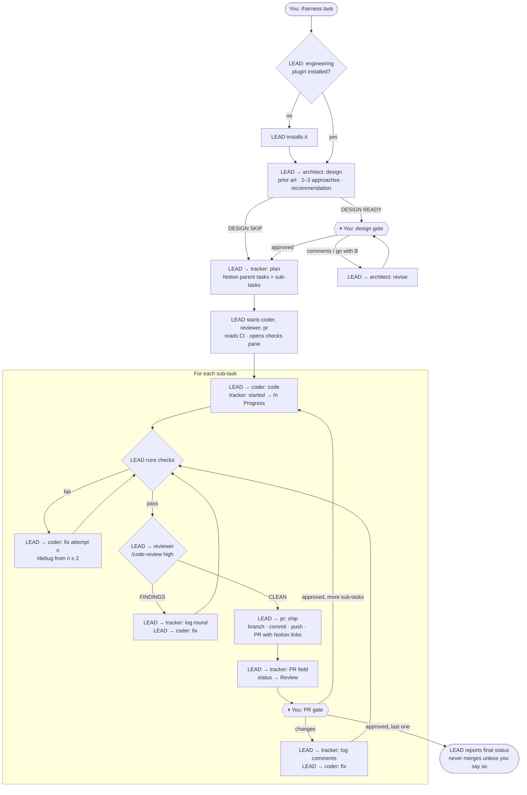

# Harness agent flow

How `/harness <task>` runs in herdr: one lead agent coordinates five helper agents, from design doc to an approved pull request for every sub-task.

Live page: https://claude.ai/artifact/CLW9mE2AZSM3ZagBQh2ojj

## Who talks to whom

Helpers never talk to each other. Every message goes through the lead (`herdr agent prompt` / `herdr agent read`).

## The whole flow

Stops early and asks you after 3 failed test runs, or 3 review rounds that still have findings.

## Where you step in

| Gate | What you do |
|---|---|
| Design gate | Approve, comment, or pick another approach ("go with B") |
| PR gate | Once per sub-task: approve, or request changes and the same PR is updated |
| Stuck | 3 failed test runs, or 3 review rounds still finding issues |

## The agents

| Agent | Job | Skills | Never |
|---|---|---|---|
| lead | Coordinates, runs checks, talks to you | harness ([SKILL.md](SKILL.md)) | Writes code, commits, edits Notion |
| architect | Design doc in `docs/design/` | system-design, architecture | Writes code or Notion |
| tracker | Notion tasks, status, PR field | Notion | Deletes tasks, writes code |
| coder | Code, fixes, tests; splits multi-area work across `coder-<area>` subagents (github-actions, cloudflare, backend, frontend, database, cloud, devops) | testing-strategy, debug | Commits, pushes |
| reviewer | Replies `REVIEW CLEAN` or `REVIEW FINDINGS` | code-review (built in) | Edits files |
| pr | Branch, commit, push, PR body with Notion links | deploy-checklist | Force-pushes, merges |

Role files: [roles/](roles/) · Coder subagents: [agents/](agents/)
