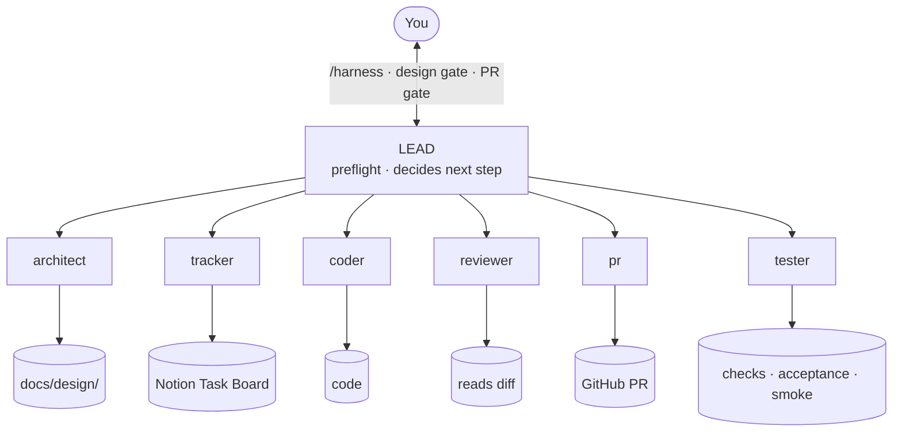
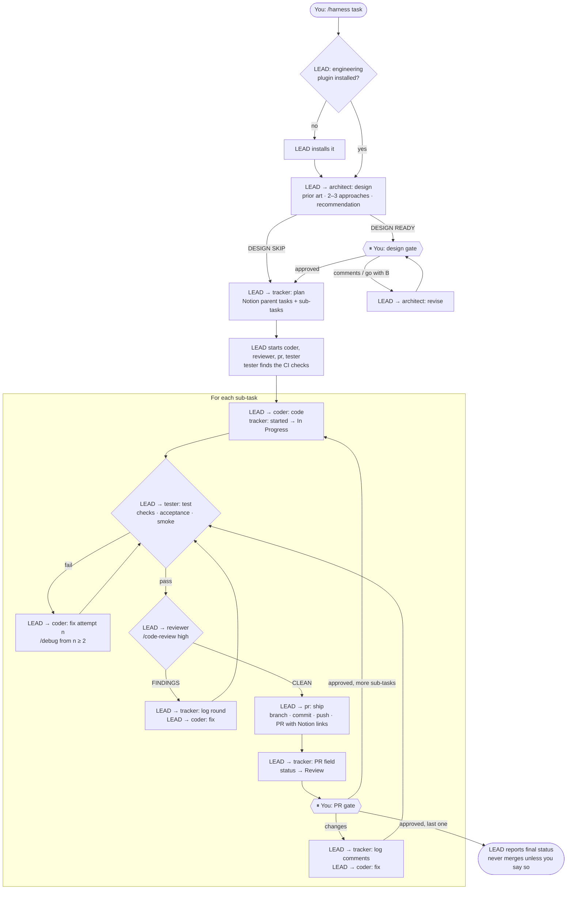

# Harness agent flow

How `/harness <task>` runs in herdr: one lead agent coordinates six helper agents, from design doc to an approved pull request for every sub-task.

Live page: https://claude.ai/artifact/CLW9mE2AZSM3ZagBQh2ojj

## Who talks to whom

Helpers never talk to each other, except the coder and the area specialists it starts. Every other message goes through the lead (`herdr agent prompt` / `herdr agent read`).



## Worktrees

`/harness <task>` is a launcher: it creates the task's worktree and workspace, starts a **brand-new lead** there with only your request, and steps away. `/harness --here <task>` skips the worktree and runs the task in the current session.

```
~/projects/
├── keynotes/          your checkout, stays on main, untouched by the harness
└── keynotes-wt/
    ├── console-login/ workspace "keynotes · console-login", branch feat/console-login, 7 tabs
    └── rate-limiting/ a second task running at the same time
```

- One worktree per task, one branch per PR. Later sub-tasks branch from fresh `origin/main` inside the same worktree
  (or stack on the previous branch if that PR isn't merged yet).
- Fix rounds, PR-gate changes and CI/CD fixes stay in the task's worktree.
- The lead copies ignored `.env*` files in (never committed); the tester installs dependencies once.
- When every PR is merged and CI/CD is green, the lead asks before removing the worktree. It never removes uncommitted or unpushed work.

## Tabs

One herdr workspace per repo, one tab per agent (herdr's own advice: "use tabs to separate views"):

| # | Tab | Panes |
|---|---|---|
| 1 | `lead` | the lead you talk to, plus your nvim sidebar (`prefix+e`) |
| 2 | `architect` | architect |
| 3 | `tracker` | tracker |
| 4 | `coder` | coder; its area specialists run as subagents inside it — watch them with `ctrl+b` `shift+z` on the coder pane |
| 5 | `tester` | tester; a second pane for a dev server and its logs when a smoke test needs one |
| 6 | `reviewer` | reviewer |
| 7 | `pr` | pr |

Agent names carry a task prefix (e.g. `rl-coder`) because herdr names are unique across the whole server.

## Keys (terminal herdr, prefix `ctrl+b`)

Tabs (numbers assume the harness created them in a fresh workspace; other open tabs shift them):

| Keys | Does |
|---|---|
| `ctrl+b` `1` … `7` | jump to lead / architect / tracker / coder / tester / reviewer / pr |
| `ctrl+b` `n` / `p` | next / previous tab |
| `ctrl+b` `g` | go-to picker |

Panes:

| Keys | Does |
|---|---|
| `ctrl+b` `h` / `j` / `k` / `l` | move left / down / up / right |
| `ctrl+b` `tab` | cycle panes |
| `ctrl+b` `z` | zoom one pane full screen (again to restore) |
| `ctrl+b` `x` | close pane (ends what's running in it) |

nvim sidebar (custom bindings in [`herdr/config.toml`](../herdr/config.toml)):

| Keys | Does |
|---|---|
| `ctrl+b` `e` | open / close the nvim sidebar |
| `ctrl+b` `shift+o` | pick a file the agent touched |
| `ctrl+b` `shift+e` | herdr's edit scrollback (moved off `e`) |
| `ctrl+b` `d` | reviewr: review the agent's diff, comment on lines, `s` sends them to the agent (needs herdr ≥ 0.9.3) |
| `ctrl+b` `shift+z` | zoetrope: live graph of the focused agent's session and tool calls (same key closes it) |

`ctrl+b` `?` shows every key.

## The whole flow



Stops early and asks you after 3 failed test runs, or 3 review rounds that still have findings.

## Status board

The lead prints this in the lead tab after every step, at every gate, and whenever you type `status`. States come from `herdr agent list`.

```
HARNESS rl · add rate limiting · step 4/5 loop · sub-task 3/7 "limiter middleware"
sub-tasks  ✅ ✅ ▶ ⬜ ⬜ ⬜ ⬜
phase      code → [test] → review → pr → your gate      round 1
agent                tab  state     doing
rl-architect          2   idle      design approved
rl-tracker            3   idle      sub-task 3 In Progress
rl-coder              4   working   waiting on specialists
  rl-coder-backend    4   working   rate limiter middleware
rl-tester             5   working   checks + smoke
rl-reviewer           6   idle      —
rl-pr                 7   idle      PR #31 open
prs        #31 ✓ #32 open
decisions  none
next       tester result, then review
```

## CI/CD after merge

After you approve a PR, the pr agent watches it in the background. Once you merge, it watches every CI/CD run on the merge
commit and reports `CICD PASS` or `CICD FAIL` to the lead. On a failure the lead reads the log, decides the cause and routes it:
app code → coder and its area specialist; infra, Terraform, Docker or workflows → the devops specialist; flaky → one re-run;
secrets, permissions, quotas or anything prod → you. The fix goes through the normal loop as a new PR, which is watched too.

## Decisions

Helpers never ask you directly. They send `ASK` with options and a recommendation to the lead (area specialists go through the coder).
The lead collects them, plus any agent stuck on a permission prompt, and asks you **once** in the lead tab as a numbered
"Decisions needed" list. Independent work keeps going while you decide.

## Where you step in

| Gate | What you do |
|---|---|
| Design gate | Approve, comment, or pick another approach ("go with B") |
| PR gate | Once per sub-task: approve, or request changes and the same PR is updated |
| Stuck | 3 failed test runs, or 3 review rounds still finding issues |

## The agents

| Agent | Job | Skills | Never |
|---|---|---|---|
| lead | Coordinates, talks to you | harness ([SKILL.md](SKILL.md)) | Writes code, commits, edits Notion |
| architect | Design doc in `docs/design/` | system-design, architecture | Writes code or Notion |
| tracker | Notion tasks, status, PR field | Notion | Deletes tasks, writes code |
| coder | Code, fixes, tests; hands every area to its own `coder-<area>` subagent (resumed across rounds, visible in zoetrope) (backend, frontend, database, devops) | testing-strategy, debug | Commits, pushes |
| tester | Runs the CI checks, acceptance and smoke tests; replies `TEST PASS` or `TEST FAIL` | testing-strategy, api-test-suite-builder, playwright-pro, performance-profiler, qa-browser-automation, data-quality-auditor | Fixes product code, commits |
| reviewer | Replies `REVIEW CLEAN` or `REVIEW FINDINGS` | code-review + security-review (built in), senior-security, ai-security, cloud-security, red-team, threat-detection, security-audit | Edits files |
| pr | Branch, commit, push, PR body with Notion links | deploy-checklist | Force-pushes, merges |

Role files: [roles/](roles/) · Coder subagents: [agents/](agents/)
